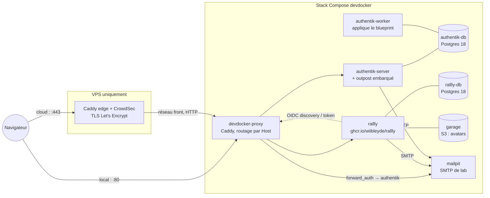
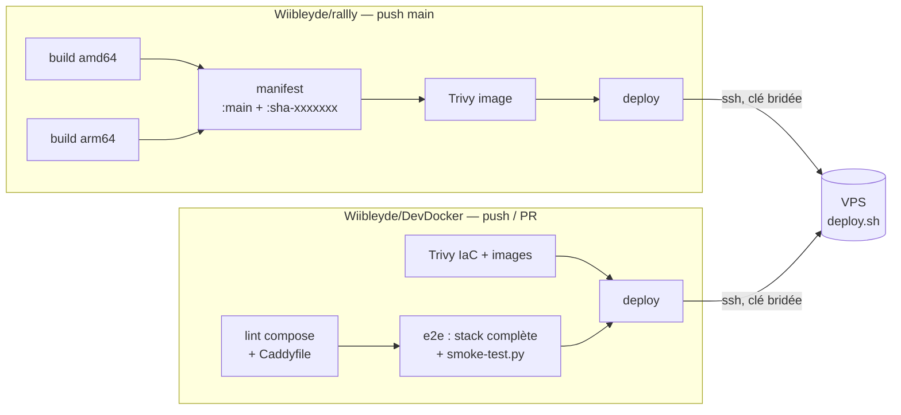

# DevDocker — Rallly derrière Authentik

Projet du module *Dev avec Docker* (M2 DEVFULLSTACK, Ynov 2026-2027) :
un environnement de développement **local et cloud** qui assemble un reverse
proxy, **Authentik** (IdP OIDC) et **Rallly** (fork avec nos features), avec une
chaîne CI/CD.

| | Local | Cloud (VPS `rivendell`) |
|---|---|---|
| Rallly | http://rallly.localhost | https://rallly.wiibleyde.dev |
| Authentik | http://authentik.localhost | https://authentik.wiibleyde.dev |
| Mailpit (admins) | http://mail.localhost | https://mail.wiibleyde.dev |

Groupe : [@Wiibleyde](https://github.com/Wiibleyde), [@Matsuel](https://github.com/Matsuel), [@WarLay0](https://github.com/WarLay0).
Fork Rallly : [Wiibleyde/rallly](https://github.com/Wiibleyde/rallly) (sous-module `rallly/`).

## Architecture



### Réseaux

| Réseau | `internal` | Membres | Rôle |
|---|---|---|---|
| `ingress` | non | proxy | seul point d'entrée (port 80 publié en local) |
| `apps` | **oui** | proxy, authentik-server, rallly, mailpit | proxy ↔ applications |
| `authentik` | **oui** | authentik-server/worker, authentik-db, mailpit | backend Authentik |
| `rallly` | **oui** | rallly, rallly-db, garage, mailpit | backend Rallly |
| `egress` | non | rallly | sortie : discovery OIDC via l'URL publique |
| `front` (VPS) | externe | proxy | réseau de l'edge Caddy de la machine |

Aucune base de données ni Garage n'a de port publié ni d'accès au proxy.
Seul le proxy est joignable depuis l'extérieur.

### Volumes

`authentik_db`, `rallly_db` (Postgres), `authentik_data` (médias Authentik),
`garage_meta` / `garage_data` (objets S3). Mailpit garde le courrier en mémoire
(`tmpfs`) : il disparaît au redémarrage, comme une boîte de lab doit le faire.

## Démarrage local

Prérequis : Docker (Compose v2), `openssl`, port **80** libre.

```bash
git clone --recurse-submodules https://github.com/Wiibleyde/DevDocker.git
cd DevDocker
scripts/init-env.sh          # crée .env et génère tous les secrets
docker compose up -d --wait  # ~2 min au premier lancement (Authentik migre sa base)
scripts/smoke-test.py        # optionnel : vérifie SSO + policies
```

`init-env.sh` affiche le mot de passe `akadmin` et celui des comptes de démo.
Ouvrir http://rallly.localhost → bouton **Authentik** → `demo-admin`.

Les navigateurs résolvent `*.localhost` vers `127.0.0.1` sans configuration.

Pour tester une modification du fork avant de la pousser :

```bash
docker compose build rallly && docker compose up -d rallly
```

Sinon `docker compose up` tire l'image publiée par la CI du fork
(`ghcr.io/wiibleyde/rallly:main`, multi-arch amd64/arm64).

## Déploiement cloud

La stack tourne sur la VPS `rivendell` (Rocky Linux 10, Docker 29), dans
`~/infra/services/devdocker`. Le sujet prévoit une VM Énov : le groupe déploie
sur sa propre VPS (écart assumé), avec la même démarche et les mêmes fichiers.

```bash
git clone https://github.com/Wiibleyde/DevDocker.git ~/infra/services/devdocker
cd ~/infra/services/devdocker
scripts/init-env.sh vps wiibleyde.dev
./deploy.sh
```

### Écarts local / cloud

Mêmes images, même `compose.yml`, même Caddyfile, même blueprint Authentik.
Seul l'override change (`COMPOSE_FILE` dans `.env`) :

| | `compose.local.yml` | `compose.vps.yml` |
|---|---|---|
| Entrée | port `127.0.0.1:80` publié | proxy attaché au réseau `front` de l'edge, aucun port publié |
| TLS | aucun (http, `*.localhost`) | terminé par l'edge Caddy (Let's Encrypt) + CrowdSec/WAF |
| Résolution de l'issuer OIDC par Rallly | alias réseau du proxy | DNS public, via l'edge |
| Image Rallly | tirée de GHCR ou `build` depuis `./rallly` | tirée de GHCR |

DNS : `rallly`, `authentik`, `mail` → A `164.132.85.232`, AAAA
`2001:41d0:20a:900::1f45`.

## Authentik

SSO, policies par groupe et invitation externe : [docs/authentik.md](docs/authentik.md).

| Compte | Accès |
|---|---|
| `akadmin` | admin Authentik |
| `demo-admin` | Rallly (peut devenir admin d'instance via `/admin-setup`) + Mailpit |
| `demo-user` | Rallly |
| `demo-denied` | refusé partout |

Mots de passe : `AUTHENTIK_BOOTSTRAP_PASSWORD` et `DEMO_PASSWORD` dans `.env`
(transmis au formateur hors dépôt).

## CI/CD



- [Fork : `devdocker-image.yml`](https://github.com/Wiibleyde/rallly/blob/main/.github/workflows/devdocker-image.yml) —
  image publiée sur `ghcr.io/wiibleyde/rallly`. `RALLLY_TAG=sha-<commit>` dans
  `.env` fige une version (rollback).
- [DevDocker : `ci.yml`](.github/workflows/ci.yml) — le job *e2e* démarre la stack
  complète sur le runner GitHub et exécute `scripts/smoke-test.py`.
- **Déploiement** : la clé SSH stockée dans l'environnement GitHub `production`
  est déclarée sur la VPS avec `command="…/deploy.sh",restrict` : elle ne peut
  que lancer `deploy.sh` (fast-forward du dépôt, `compose pull`, `up --wait`).
  Pas de runner self-hosted : sur un dépôt public il exécuterait le code des PR
  de forks sur une machine qui héberge d'autres services.

## Sécurité

Durcissement, scans et limites assumées : [docs/security.md](docs/security.md).

## Features Rallly

Développées sur des branches du fork ; une fois fusionnées dans `main`, la CI
du fork les publie (`ghcr.io/wiibleyde/rallly:main`) et les déploie.

| Feature | Type | Branche | État |
|---|---|---|---|
| Expiration automatique du sondage | catalogue #4 | `feat/expiration-option` | branche poussée, pas encore fusionnée |
| Notifications in-app (inbox) | libre | `feat/inbox-notifications` | en cours |
