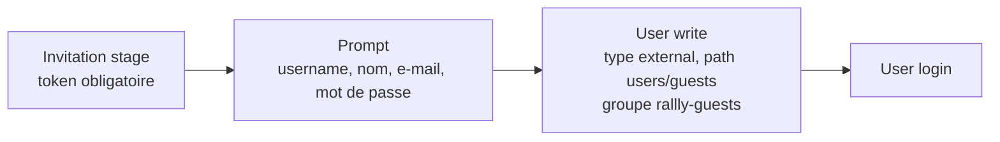

# Authentik — SSO, policies par groupe, invitation externe

Toute la configuration Authentik du projet est **déclarative** :
[`authentik/blueprints/devdocker.yaml`](../authentik/blueprints/devdocker.yaml),
monté dans `/blueprints/custom` et appliqué par le worker au démarrage puis à
chaque modification du fichier. Aucun clic n'est nécessaire pour reproduire
l'environnement ; l'UI admin sert à constater et à faire la démo.

Les valeurs qui changent entre local et VPS (URL publiques, secret client)
arrivent par les variables `DEVDOCKER_*` posées dans `compose.yml` et lues
via `!Env`.

## 1. SSO Rallly (OIDC)

| Élément | Valeur |
|---|---|
| Provider | `Rallly` — OAuth2/OpenID, client confidentiel |
| Client ID / secret | `RALLLY_OIDC_CLIENT_ID` / `RALLLY_OIDC_CLIENT_SECRET` (`.env`) |
| Redirect URI (strict) | `<NEXT_PUBLIC_BASE_URL>/api/auth/callback/oidc` |
| Scopes | `openid email profile` (mappings gérés par Authentik) |
| Signature | RS256, certificat auto-signé d'Authentik |
| Flow d'autorisation | `default-provider-authorization-implicit-consent` |
| Discovery (côté Rallly) | `<AUTHENTIK_URL>/application/o/rallly/.well-known/openid-configuration` |

Côté Rallly (`compose.yml`) : `OIDC_DISCOVERY_URL`, `OIDC_CLIENT_ID`,
`OIDC_CLIENT_SECRET`, et `EMAIL_LOGIN_ENABLED=false`. Sans connexion par e-mail,
`/login` redirige directement vers Authentik : il n'existe pas de chemin qui
contourne l'IdP et ses policies.

`INITIAL_ADMIN_EMAIL=demo-admin@<DEMO_EMAIL_DOMAIN>` autorise `demo-admin`, et
lui seul, à se promouvoir admin de l'instance Rallly : une fois, via
`/admin-setup`, puis panneau `/control-panel`.

### Pièges rencontrés

- **L'issuer doit être identique pour le navigateur et pour Rallly.** Rallly
  télécharge le document de discovery côté serveur. En local,
  `authentik.localhost` pointe sur `127.0.0.1` *dans le conteneur* : le proxy
  porte donc ce nom en alias réseau (`compose.local.yml`) et écoute sur le même
  port 80 que celui publié. Sur la VPS, Rallly passe par le DNS public et l'edge
  (réseau `egress`).
- **X-Forwarded-Proto.** Sur la VPS, TLS est terminé par l'edge Caddy. Le Caddy
  du projet fait confiance aux plages privées (`trusted_proxies`) pour conserver
  `https`, sinon Authentik génère des URL `http://` et la redirect URI ne
  correspond plus.
- **Redirect URI stricte.** Toute différence (schéma, slash final, port) donne
  « Redirect URI Error » : elle est dérivée de la même variable que
  `NEXT_PUBLIC_BASE_URL`.

## 2. Policies par groupe

| Groupe | Rallly | Mailpit | Membres de démo |
|---|---|---|---|
| `rallly-admins` | ✅ (admin d'instance) | ✅ | `demo-admin` |
| `rallly-users` | ✅ | ❌ | `demo-user` |
| `rallly-guests` | ✅ | ❌ | utilisateurs créés par invitation |
| *(aucun)* | ❌ | ❌ | `demo-denied` |

Chaque application a des **policy bindings de groupe** et le mode `any` : un
seul binding satisfait suffit, aucun binding satisfait = accès refusé par
Authentik (« Permission denied ») *avant* tout retour vers l'application.

Mailpit n'a pas d'authentification propre. Il est protégé par un **provider
proxy** en mode *forward auth (single application)* servi par l'outpost
embarqué d'Authentik ; le Caddy du projet appelle
`authentik-server:9000/outpost.goauthentik.io/auth/caddy` (`forward_auth`)
avant chaque requête vers `mail.*`.

Démo :

1. `demo-user` → Rallly : connecté. → `mail.*` : refusé.
2. `demo-admin` → Rallly : connecté, peut devenir admin via `/admin-setup`. → `mail.*` : inbox.
3. `demo-denied` → Rallly : « Permission denied » sur Authentik.

`scripts/smoke-test.py` rejoue ces trois parcours sans navigateur, ainsi que
l'invitation ci-dessous (création par `akadmin`, enrôlement, connexion Rallly,
rejeu refusé) ; la CI l'exécute à chaque push.

## 3. Invitation d'un utilisateur externe

Flow d'enrôlement `devdocker-invitation` :

Sans `itoken` valide le flow s'arrête à la première étape.

Procédure (admin `akadmin`) :

1. **Directory → Invitations → Create** : nom, flow `devdocker-invitation`,
   *single use*, expiration ; optionnellement `fixed_data` pour pré-remplir
   l'e-mail : `{"email": "invite@exemple.fr"}`.
2. Copier le lien affiché :
   `<AUTHENTIK_URL>/if/flow/devdocker-invitation/?itoken=<uuid>`
   et l'envoyer à l'invité (mail, chat).
3. L'invité choisit identifiant et mot de passe ; il est connecté et placé dans
   `rallly-guests`.
4. Il ouvre Rallly → bouton « Authentik » → connecté sans autre étape.
5. Le lien à usage unique est consommé : une seconde ouverture est refusée.

Les e-mails émis par Authentik (récupération de mot de passe…) et par Rallly
(invitations aux sondages, notifications) arrivent dans Mailpit
(`mail.*`, réservé à `rallly-admins`).

## Comptes

| Compte | Mot de passe | Rôle |
|---|---|---|
| `akadmin` | `AUTHENTIK_BOOTSTRAP_PASSWORD` | super-admin Authentik |
| `demo-admin` | `DEMO_PASSWORD` | `rallly-admins` |
| `demo-user` | `DEMO_PASSWORD` | `rallly-users` |
| `demo-denied` | `DEMO_PASSWORD` | aucun groupe |

Les comptes de démo sont créés une seule fois (`state: created`) : un mot de
passe changé pendant une démo n'est pas écrasé au redémarrage suivant.
